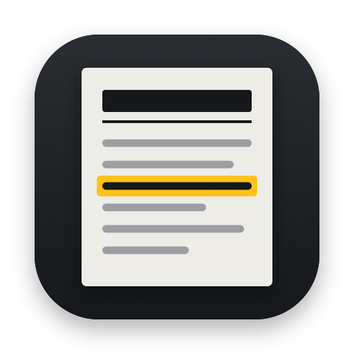
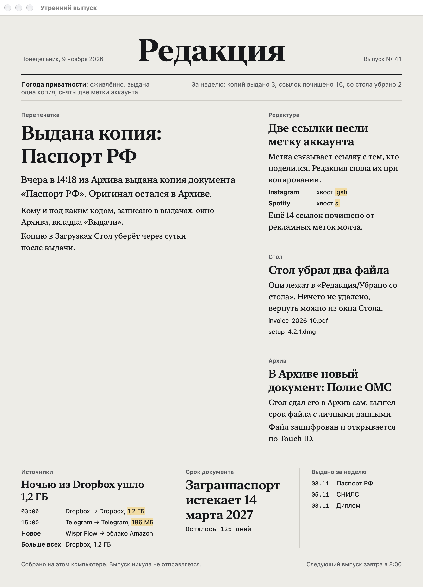
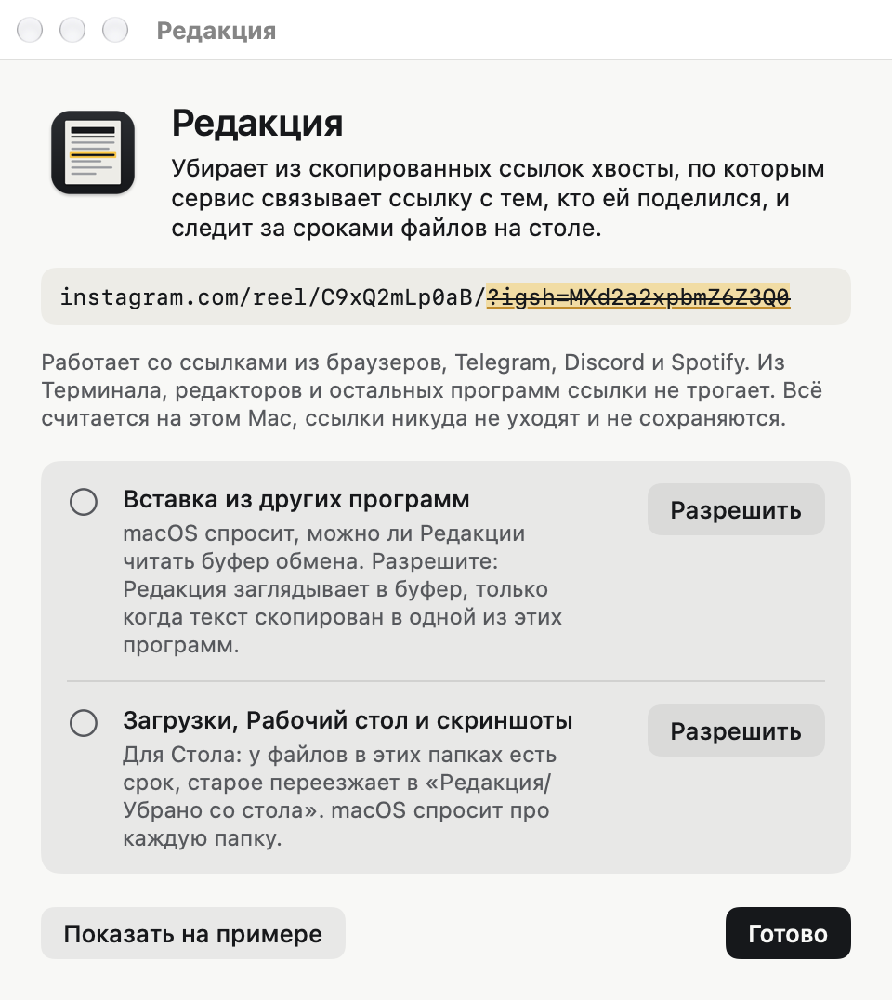
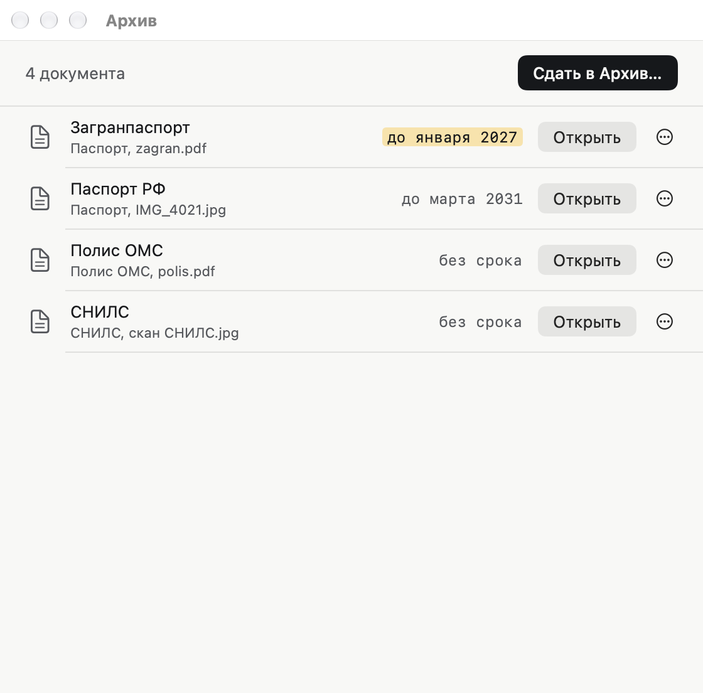
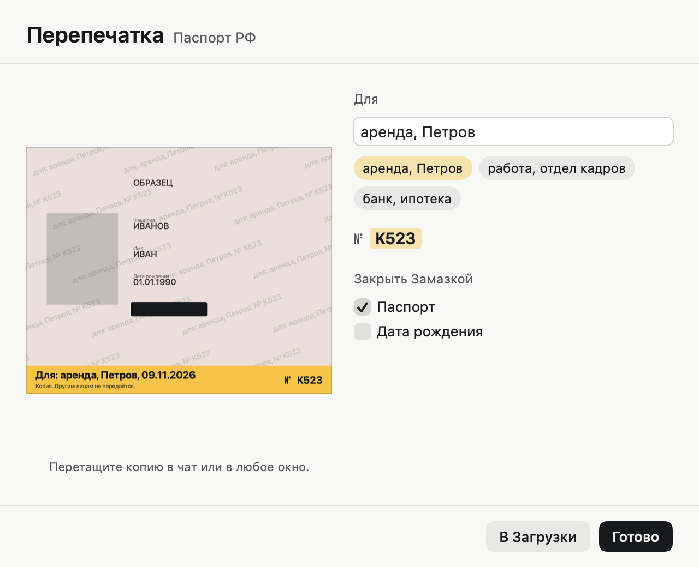

<p align="center">
  
</p>

<h1 align="center">Редакция</h1>

<p align="center">
  Решает, что о тебе уходит с компьютера, хранит оригиналы документов и каждое утро выпускает газету о том, что было.<br>
  Живёт в строке меню. Всё считается на этом Mac.
</p>

<p align="center">
  <a href="https://github.com/vldvr/amendment/releases/latest"><b>Скачать последнюю версию</b></a>
</p>



Сейчас готова версия для macOS. Версия для Windows в работе: правила и тестовые случаи у них общие (`spec/`).

## Что внутри

| Рубрика | Что делает |
|---|---|
| **Редактура** | Убирает хвосты из скопированных ссылок. Метки, которые связывают ссылку с твоим аккаунтом (`igsh`, `si`, хвост TikTok), показывает карточкой. Рекламные (`utm_*`, `fbclid`, `ysclid`) убирает молча. Внутри — Замазка: прячет личные данные на скриншотах |
| **Стол** | У Загрузок, Рабочего стола и скриншотов есть срок: 30 дней, 14 для файлов с личными данными, 3 для копий. Старое переезжает в папку «Убрано со стола», документы — в Архив. Ничего не удаляется |
| **Архив** | Документы в зашифрованном виде. Каждое открытие подтверждается Touch ID. Ключ восстановления — 12 слов на бумаге |
| **Перепечатка** | Наружу уходит не оригинал, а копия с подписью «Для: …» и коротким кодом выдачи. Лишние поля закрыты, метаданные убраны. Каждая выдача записывается в журнал, копия в Загрузках убирается через сутки |
| **Источники** | С какими компаниями говорили программы за день: новые знакомства, ночные соединения, крупные отправки |
| **Утренний выпуск** | Газета из событий всех рубрик. Выходит раз в день, в 8:00 по умолчанию |

### Редактура



Ссылка трогается, только если её скопировали в браузере, Telegram, Discord или Spotify. Скопированное в терминале, редакторе кода или таблице остаётся как было. «Вернуть хвост» возвращает исходный буфер одним нажатием. Правила лежат в [`spec/link-rules.json`](spec/link-rules.json) и обновляются раз в сутки из публичного репозитория [vldvr/redakciya-rules](https://github.com/vldvr/redakciya-rules).

### Стол и Архив



Файлы Архива — обычный формат [age](https://age-encryption.org): два получателя, ключ в Secure Enclave этого Mac и ключ из 12 слов. Если Редакции не станет, документы открываются без неё:

```bash
python3 spec/tools/words-to-age-key.py > key.txt   # спросит 12 слов
age -d -i key.txt паспорт.age > паспорт.pdf
```

Формат описан в [`spec/archive-format.md`](spec/archive-format.md) вместе с тестовыми векторами.

### Перепечатка



Копию можно перетащить прямо в Telegram или сохранить в Загрузки. Если копия всплыла где-то потом, «Найти по копии» прочтёт код с картинки и покажет, кому она выдана. Журнал выдач лежит в Архиве и шифруется так же.

### Источники

Соединения видны через системный счётчик ядра (`com.apple.network.statistics`, как у `nettop`), без прав администратора. Адрес сразу превращается в компанию по базе [iptoasn](https://iptoasn.com) и не записывается: в журнал за час попадают только программа, компания и объём. Чего рубрика не умеет: показывать сайты и домены, говорить, кто стоит за облаком Amazon или Google, видеть соединения системных служб, блокировать.

## Что уходит в сеть

Один запрос раз в сутки: файл правил ссылок с `raw.githubusercontent.com`, без cookies и данных о тебе. Скриншоты, документы, Архив, журнал и выпуски никуда не отправляются. База компаний для «Источников» лежит внутри приложения.

## Установка

Нужна macOS 14 или новее, Apple silicon или Intel.

### Собрать у себя (рекомендуется)

Нужны Command Line Tools (`xcode-select --install`) и Python 3.

```bash
git clone https://github.com/vldvr/amendment.git
cd amendment
mac/scripts/fetch-asn.sh                       # база компаний для «Источников»
swift run --package-path mac redakciya-checks  # проверки
mac/scripts/build-app.sh --install             # сборка и копия в /Applications
```

Собранное на своём Mac приложение не получает карантинный атрибут, и Gatekeeper его не останавливает. Запускается ровно тот код, который лежит перед глазами. Для программы, которая видит буфер обмена и Загрузки, это честнее, чем просить доверять готовому файлу.

### Готовый образ

На странице [последней версии](https://github.com/vldvr/amendment/releases/latest) лежат `Redakciya-…-macOS.dmg` и его SHA-256. Сначала образ можно проверить:

```bash
shasum -a 256 -c Redakciya-0.1.0-macOS.dmg.sha256
gh attestation verify Redakciya-0.1.0-macOS.dmg --repo vldvr/amendment
```

Вторая команда проверяет подпись происхождения (Sigstore): образ собран GitHub Actions из этого репозитория, из коммита с тегом версии.

У проекта нет платного сертификата Apple, поэтому при первом запуске macOS скажет, что не может проверить разработчика:

1. Перетащи «Редакцию» из образа в «Программы» и открой её. macOS покажет предупреждение — нажми «Готово».
2. Открой «Системные настройки» → «Конфиденциальность и безопасность».
3. Внизу будет строка «Программа „Redakciya“ заблокирована». Нажми «Всё равно открыть» и подтверди паролем или Touch ID.

Это нужно один раз. Убрать предупреждение совсем можно только сертификатом Developer ID и нотаризацией Apple (99 $ в год). Снимать карантин командой `xattr` не советуем: это обход проверки вслепую.

## Разрешения

- Вставка из других программ. macOS спросит при первом запуске: без этого Редактура не видит скопированную ссылку. Читается только простой текст и только из программ, где делятся ссылками.
- Загрузки, Рабочий стол, Документы — для Стола, по кнопке «Разрешить» в знакомстве или настройках.
- Touch ID — на каждое открытие Архива.
- Открытие при входе выключено, включается в настройках.

Чужие базы паролей, cookies и сессии мессенджеров Редакция не читает.

## Разработка

```bash
swift run --package-path mac redakciya-checks          # все проверки
swift run --package-path mac redakciya-checks sources-live   # с настоящей сетью, по имени
mac/scripts/build-app.sh                               # быстрая сборка под этот Mac
mac/scripts/build-app.sh --dmg                         # Apple silicon + Intel и dist/Redakciya-<версия>-macOS.dmg
mac/scripts/sync-spec.sh                               # вшить правила и шаблоны из spec/
```

`spec/` — единственный источник правды для обеих платформ: правила, тестовые случаи, шаблоны газеты, формат Архива. У каждого спека есть эталон на Python в `spec/tools/`, и реализации на Swift и Rust проходят тот же корпус.

Журнал для отладки: `~/Library/Logs/Redakciya.log`. Туда пишутся события, но не ссылки, адреса и содержимое файлов.

## Лицензия

[MIT](LICENSE)
